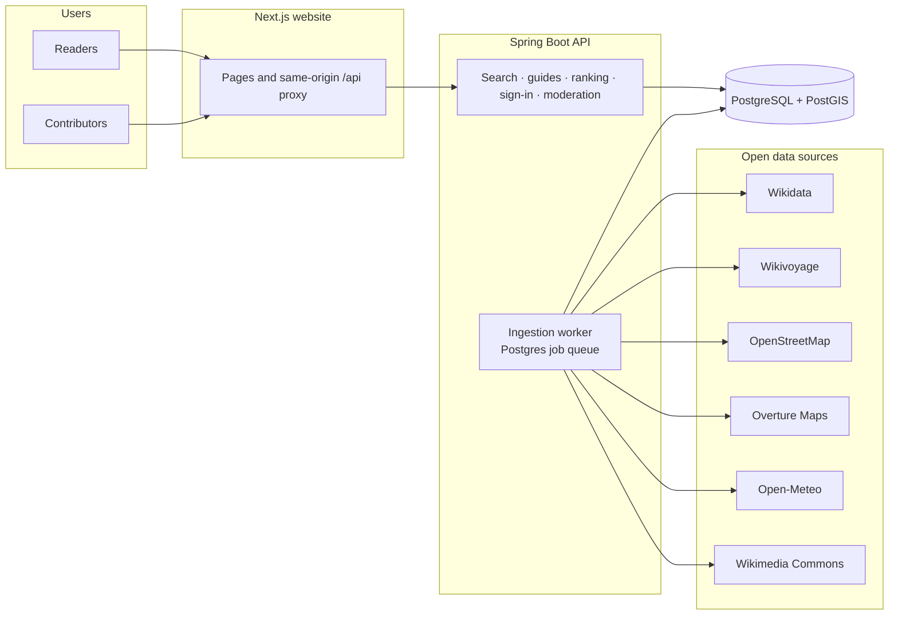
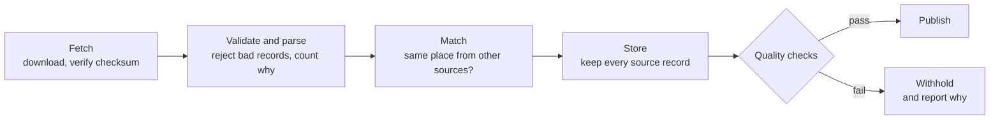
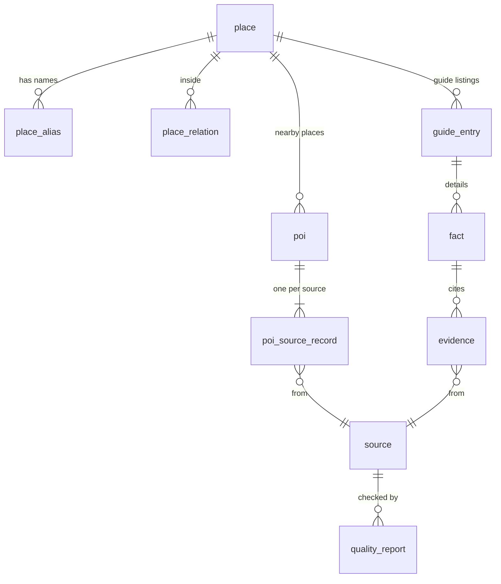

# Saarthi — Travel Unfolded

**A free, open travel guide to India, and the open dataset behind it.**

Saarthi helps you plan a trip anywhere in India: where to eat, where to stay, what to see, what things cost and
how to get around. Every detail shows where it came from, and locals can confirm or correct it. There are no ads,
no paid rankings, and nothing is generated by AI when you search.

It is two things in one repository:

1. **A website** (Next.js) and **API** (Spring Boot) that readers and contributors use.
2. **A clean, source-tracked database of places in India** that anyone can rebuild, query and reuse.

---

## Contents

1. [What's in the data](#whats-in-the-data)
2. [How it fits together](#how-it-fits-together)
3. [How the data is built](#how-the-data-is-built)
4. [Using the data](#using-the-data)
5. [Quick start](#quick-start)
6. [Local development](#local-development)
7. [Configuration](#configuration)
8. [Deploying](#deploying)
9. [Testing](#testing)
10. [API](#api)
11. [Licences](#licences)

---

## What's in the data

Everything lives in one PostgreSQL + PostGIS database. After a full import it holds:

| What | How many | From |
| --- | --- | --- |
| **Destinations**: states, districts, cities, towns, villages, parks, islands | 2,484 | Wikidata |
| **Names and aliases** (including 13 Indian scripts: "Bombay" → Mumbai, "बेंगलुरु" → Bengaluru) | 23,017 | Wikidata |
| **Administrative links** (place → district → state) | 3,773 | Wikidata |
| **Mapped places**: restaurants, hotels, sights, parks, stations, markets… | 411,630 | OpenStreetMap, Overture Maps, ASI monuments |
| **Source records** behind those places (one per source, nothing thrown away) | 440,182 | same |
| **Guide entries and facts**: written tips, prices, hours, addresses, with evidence links | 752 entries · 2,601 facts | Wikivoyage |
| **Climate**: monthly averages from ten years of daily weather | per guide destination | Open-Meteo |
| **Photos** with author and licence | per guide destination | Wikimedia Commons |

The mapped places by kind: 140,100 places to eat, 132,098 stays, 59,908 sights, 37,391 drinks, 23,304 transport
stops, 13,786 shops and 5,043 activities, spread over all 36 states and union territories.

### What makes it reusable

- **One place, many sources, nothing lost.** When OpenStreetMap and Overture describe the same restaurant
  (18,191 places so far), you get *one* place linked to *both* source records, each keeping its original id,
  release version and raw attributes. You can always go back to the source.
- **Matches are explained.** Every merge or non-merge records the rule that decided it (shared phone number, same
  name nearby, chain branch…), so you can audit or tighten them.
- **Quality is measured, not claimed.** Each import is checked (schema, completeness, location, duplicates,
  cross-source agreement, provenance, coverage). If a source fails its checks, its data is withheld. Reports are
  stored and shown at `/sources/{id}`.
- **Licences travel with the data.** Every record points to its source and licence.

---

## How it fits together



- **Reading** a guide is pure database work: indexed queries, then a fixed, explainable ranking. No outside call
  and no AI happens while someone browses.
- **Contributing** (confirming "Still true?", correcting, adding a place) goes through moderation and is recorded in
  an audit log.
- **Ingestion** runs inside the API as background jobs, one at a time, safe to re-run.

---

## How the data is built

Every source goes through the same steps, and each run is recorded with real counts.



**How two sources become one place.** Records are matched in this order: same source id, same Wikidata link,
then name and distance within compatible categories. Near-misses are decided by evidence rules (a shared phone
number or website means same place; a chain's other branch means a different one). Anything left over becomes
its own place. Two things are never merged automatically: places of different kinds, and branches of a chain.

**What gets stored from each source**

| Source | Taken | Licence |
| --- | --- | --- |
| Wikidata | destinations, names, administrative links, ASI monument numbers | CC0 |
| Wikivoyage | guide text, prices, hours, addresses (each fact links to its exact article revision) | CC BY-SA 4.0 |
| OpenStreetMap | named places in travel categories, including areas mapped as parks and forts | ODbL 1.0 |
| Overture Maps | more places near destinations, confidence ≥ 0.6 | CDLA Permissive 2.0 / Apache 2.0 / CC0 per record |
| Open-Meteo | monthly climate averages | CC BY 4.0 |
| Wikimedia Commons | one photo per destination, credited | per photo |

**Honest limits**
- Mapped places are map data, not recommendations. They have not been reviewed, and opening hours exist for only
  about 8% of OpenStreetMap places.
- Only 3 destinations (Bengaluru, Kochi, Mysuru) have full written guides so far; the rest have the destination
  index and nearby mapped places.
- Some sources aren't open to use: the India Meteorological Department needs whitelisted access, and data.gov.in
  and Incredible India have no usable place-level open data.

---

## Using the data

### Rebuild it yourself

Run the app (see [Quick start](#quick-start)); it fills the database from the open sources above. Imports are
idempotent. You can also start them one by one as an administrator at `/admin`:

| Job | What it does |
| --- | --- |
| `wikidata_index` | destinations, names, administrative links |
| `wikivoyage_guide` | one destination's guide |
| `osm_extract` | India extract from Geofabrik (about 1.6 GB download) |
| `overture_places` | Overture places near destinations (about 1.3 GB download) |
| `heritage_monuments` | ASI-numbered monuments from Wikidata |
| `climate`, `place_image` | weather and photo for a destination |

### Query it

It is plain Postgres. The main tables:



| Table | One row is… |
| --- | --- |
| `place` | a destination (state, district, city, town…) with coordinates |
| `place_alias` | a name for a place, in any language |
| `poi` | one real-world mapped place (restaurant, hotel, sight…) |
| `poi_source_record` | what one source says about that place, with its raw attributes |
| `guide_entry` / `fact` / `evidence` | a written listing, a detail about it, and where the detail came from |
| `source`, `source_sync_run`, `quality_report` | each source, each import run, each quality check |

Examples:

```sql
-- Places to eat near Kochi
SELECT p.name, p.category, p.latitude, p.longitude
FROM poi p JOIN place d ON d.id = p.destination_id
WHERE d.slug = 'kochi' AND p.category_group = 'eat' AND p.status = 'active';

-- Old and alternate names
SELECT p.name, a.alias
FROM place p JOIN place_alias a ON a.place_id = p.id
WHERE a.normalized = idi_normalize('bombay') AND p.is_destination;

-- The same place as described by each source
SELECT p.name, r.source_id, r.external_id
FROM poi p JOIN poi_source_record r ON r.poi_id = p.id
WHERE p.name = 'Hanuman Veg Restaurant';
```

Place categories are `eat`, `drink`, `stay`, `see`, `do`, `buy` and `transport`. Distances use PostGIS
(`geog` columns).

### Read it through the API

A running instance serves the data as JSON with no account needed: `/api/destinations`, `/api/search?q=`,
`/api/destinations/{slug}/mapped-places`, `/api/sources` (with each source's quality report). See [API](#api).

### Before you reuse it

Data keeps the licence of its source, and **OpenStreetMap's ODbL is share-alike**: if you publish a database
derived from the mapped places, you must offer it under the same licence and credit "© OpenStreetMap
contributors". Overture records carry their own licences too (some require crediting Foursquare). Details are in
[DATA_LICENSES.md](DATA_LICENSES.md).

---

## Quick start

Requirements: Docker with Compose v2, about 4 GB of free memory, and internet access.

```bash
cp .env.example .env
```

Edit `.env`: set `APP_ADMIN_EMAILS` to your email (to get the admin console) and `INGESTION_CONTACT` to a URL or
email where Wikimedia can reach you. On Apple Silicon also set `POSTGIS_IMAGE=imresamu/postgis:17-3.5`. Then:

```bash
docker compose up --build
```

| Service | URL |
| --- | --- |
| Website | http://localhost:3000 |
| Sign-in emails (Mailpit, development only) | http://localhost:8025 |
| PostgreSQL + PostGIS | `localhost:5433` (user and password from `.env`) |

On first start the API sets up the database and begins importing in the background: first the launch guides
(Mysuru and Bengaluru), then the nationwide destination index. The first guides appear within minutes; the
rest takes longer because Wikidata rate-limits shared access. Progress is visible at `/sources`. The big map
imports (OpenStreetMap, Overture) are not started automatically; run them from `/admin`.

## Local development

Run the database in Docker and the apps from source:

```bash
docker compose up -d db mailpit
./scripts/dev-api.sh
```

```bash
cd frontend && npm ci && npm run dev
```

The API listens on http://localhost:8080 (JDK 21+, Maven 3.9+) and the website on http://localhost:3000.

| Task | Command |
| --- | --- |
| Backend tests (needs Docker) | `cd backend && mvn verify` |
| Frontend tests | `cd frontend && npm test` |
| Type check and lint | `cd frontend && npm run typecheck && npm run lint` |
| Production build | `cd frontend && npm run build` |

Reset the local database (deletes all imported data and accounts): `docker compose down -v`.

## Configuration

Everything is set with environment variables; `.env.example` lists them all with explanations. The main ones:

| Variable | Purpose |
| --- | --- |
| `DATABASE_URL`, `DATABASE_USERNAME`, `DATABASE_PASSWORD` | Database connection (`DATABASE_URL` must start with `jdbc:postgresql://`) |
| `APP_PUBLIC_URL` | The public address of the website; used in sign-in links and OAuth redirects |
| `APP_ADMIN_EMAILS` | Emails that become administrators after signing in |
| `SMTP_HOST`, `SMTP_PORT`, `SMTP_USERNAME`, `SMTP_PASSWORD`, `SMTP_AUTH`, `SMTP_STARTTLS`, `MAIL_FROM` | Email sign-in (empty `SMTP_HOST` turns it off) |
| `GOOGLE_CLIENT_ID` / `_SECRET`, `GITHUB_CLIENT_ID` / `_SECRET` | Optional OAuth sign-in |
| `INGESTION_ENABLED`, `INGESTION_BOOTSTRAP` | Run background imports; import the launch guides on first start |
| `COOKIE_SECURE` | `true` when served over HTTPS |
| `TRUST_FORWARDED_HEADERS` (API), `TRUST_PROXY_HEADERS` (website) | Use the visitor address from a trusted proxy for rate limiting |
| `API_DOCS_ENABLED` | `false` hides the public API documentation |
| `BACKEND_INTERNAL_URL`, `NEXT_PUBLIC_SITE_URL` | Website settings: where the API is, and the site's own address (set before building) |

Ranking, freshness and trust thresholds are in `backend/src/main/resources/application.yml`.

## Deploying

The repository builds two Docker images (`backend/Dockerfile` and `frontend/Dockerfile`), and the database is
standard PostgreSQL 17 with the `postgis`, `pg_trgm` and `unaccent` extensions, so it runs on any container host.

1. Create the database and enable the three extensions.
2. Fill it by running the imports there, or restore a dump of a database you built elsewhere
   (`pg_dump -Fc` then `pg_restore`). The OpenStreetMap and Overture imports download several GB, so building
   locally and restoring is often easier.
3. Deploy the API (a private service if possible) with the database variables above, `COOKIE_SECURE=true`,
   `APP_PUBLIC_URL`, `APP_ADMIN_EMAILS`, real SMTP settings, and `INGESTION_ENABLED=false` unless you want imports
   to run on the server.
4. Deploy the website pointing `BACKEND_INTERNAL_URL` at the API, with `NEXT_PUBLIC_SITE_URL` set to its public
   address at build time.

Run a **single API instance**: imports run one job at a time and rate limiting is in memory.

## Testing

| Suite | Where | What it covers |
| --- | --- | --- |
| Backend unit tests | `backend/src/test` | ranking, freshness, parsing, place matching rules, categories, OSM file reading |
| Backend integration tests | `backend/src/test/.../it` | real PostGIS via Testcontainers: migrations, search, guides, imports, matching, quality gates, sign-in, moderation |
| Frontend tests | `frontend/tests` | search, preferences, provenance display, forms, accessibility checks |
| End-to-end tests | `frontend/e2e` | the full stack in a browser |

On Apple Silicon set `TEST_POSTGIS_IMAGE=imresamu/postgis:17-3.5`. External sources are replaced in tests by a
local stub with synthetic fixtures that are never used outside tests. End-to-end tests need a running stack with
at least one guide and an administrator email:

```bash
cd frontend && npx playwright install chromium
E2E_BASE_URL=http://localhost:3000 E2E_ADMIN_EMAIL=admin@example.test npm run e2e
```

## API

Interactive documentation is at `/swagger-ui.html` on the API (unless disabled). Highlights:

| Endpoint | Access |
| --- | --- |
| `GET /api/search?q=` | public |
| `GET /api/destinations`, `GET /api/destinations/{slug}` | public |
| `GET /api/destinations/{slug}/sections/{eat\|stay\|explore}` | public |
| `GET /api/destinations/{slug}/mapped-places` | public |
| `GET /api/destinations/{slug}/{neighbourhoods\|budget\|getting-around\|tips}` | public |
| `GET /api/sources`, `GET /api/sources/{id}/quality`, `GET /api/meta` | public |
| `POST /api/contributions`, `POST /api/facts/{id}/verifications`, `/api/me/**` | signed-in contributor |
| `/api/moderation/**` | trusted contributor, steward or admin |
| `/api/admin/**` | admin |

Errors use RFC 9457 problem documents with a stable `code`. Changing requests need the `X-XSRF-TOKEN` header that
matches the `XSRF-TOKEN` cookie (issued by `GET /api/auth/session`).

## Licences

- **Software:** [Apache-2.0](LICENSE).
- **Data** is not covered by the software licence; it keeps its source's licence. See
  [DATA_LICENSES.md](DATA_LICENSES.md) and the `/sources` page of a running instance.
- **Contributions** made through the site are licensed CC BY-SA 4.0 by their contributors.

Built with Java 21, Spring Boot 4, PostgreSQL 17 + PostGIS, Next.js 16, React 19 and Tailwind CSS 4.

See also [CONTRIBUTING.md](CONTRIBUTING.md), [CODE_OF_CONDUCT.md](CODE_OF_CONDUCT.md) and [SECURITY.md](SECURITY.md).
